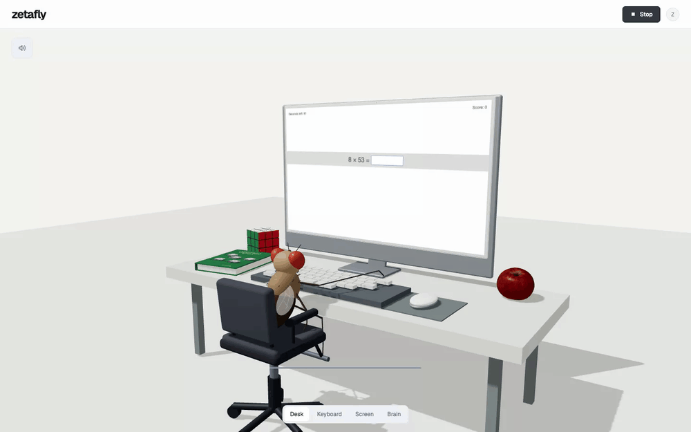
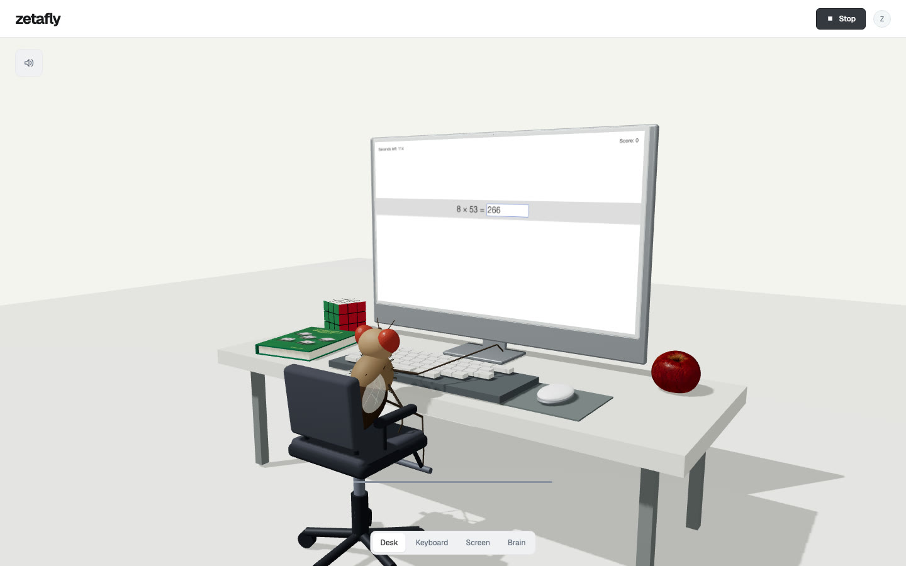
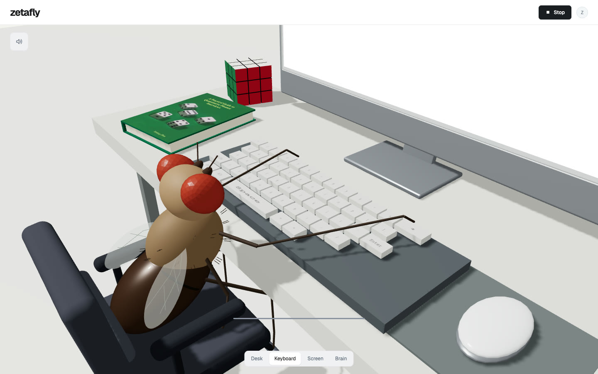
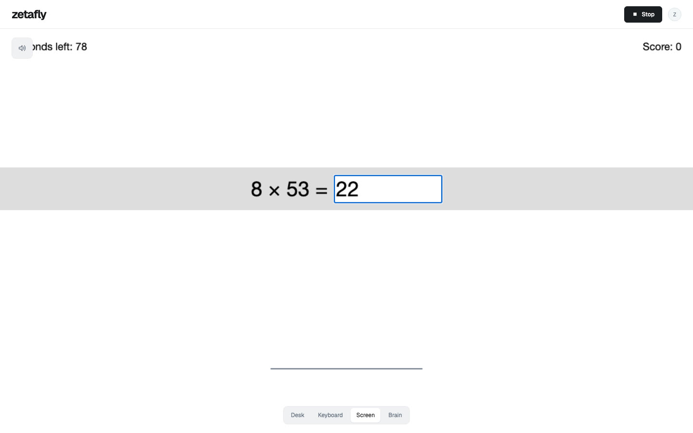
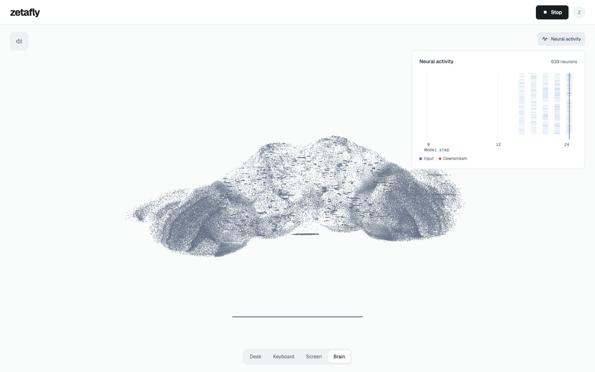

# Zetafly

A fruit fly playing Zetamac, built on the MERN stack.



<details>
<summary>Screenshots</summary>






</details>

## Requirements

- Node.js 24.12–24.x
- Docker with Compose 2.24.4+
- Git
- macOS, Linux, or WSL
- 4 GB available RAM

## Installation

```sh
git clone https://github.com/milesrack/zetafly.git
cd zetafly
npm ci
npm run setup
docker compose up --build -d
```

- App: [localhost:3000](http://localhost:3000)
- Email: [localhost:8025](http://localhost:8025)

## Configuration

Edit `.env` for production:

| Variable             | Value                                                            |
| -------------------- | ---------------------------------------------------------------- |
| `MONGODB_URI`        | Empty for Docker MongoDB, or an external connection string       |
| `MONGODB_DATABASE`   | `zetafly`                                                        |
| `BETTER_AUTH_SECRET` | Generated by `npm run setup`                                     |
| `BETTER_AUTH_URL`    | `http://localhost:3000` locally, your HTTPS origin in production |
| `RESEND_API_KEY`     | Empty locally, your Resend API key in production                 |
| `EMAIL_FROM`         | Local default, or a sender on your verified domain               |

[Verify your sender domain in Resend](https://resend.com/docs/dashboard/domains/introduction).

## Development

```sh
npm run dev --workspace web
docker compose up --build -d app
npm run check
```

[Contributing](CONTRIBUTING.md)

## Deployment

Merges to `main` deploy through GitHub Actions.

1. Install Docker Engine, Compose, Apache, and Certbot. Enable Apache's `ssl`, `proxy`, `proxy_http`, and `headers` modules.
2. Create a `deploy` account with Docker access and ownership of `/var/www/zetafly/releases` and `/var/www/zetafly/shared`. Save the production `.env` as `shared/.env`.
3. Point the domain at the server, issue its TLS certificate, and install [the Apache site](deploy/apache/zetafly.conf). For another domain, update the Apache hostname, certificate paths, and deployment workflow URLs. Run `apache2ctl configtest` before reloading Apache.
4. Add `DEPLOY_SSH_KEY` to the GitHub `production` environment's secrets. Set its `DEPLOY_HOST` and `DEPLOY_KNOWN_HOSTS` variables to the server address and pinned SSH host key.

- Releases: `/var/www/zetafly/releases`
- Active: `/var/www/zetafly/current`

Back up the MongoDB volume and `shared/.env`. Roll back by running Compose from the previous release and repointing `current`.

## Training

```sh
npm run model:fetch
npm run sequence:train -- --seed 42 --output output/my-fly.npz
npm run model:predict -- --model output/my-fly.npz --expression '17*6'
npm run model:inspect -- output/my-fly.npz
```

Upload `output/my-fly.npz` in **Settings → Weights**.

To continue training:

```sh
npm run sequence:train -- --initial output/my-fly.latest.npz --output output/my-fly.npz
```

## API

Import [openapi.yaml](openapi.yaml) into SwaggerHub.

## Credits

- [Shiu et al.](https://github.com/philshiu/Drosophila_brain_model): connectivity and reference simulator.
- [FlyWire](https://github.com/flyconnectome/flywire_annotations): anatomical annotations.
- [S Sudharsan's Flylab](https://github.com/Sudharsanselvaraj/Flylab): fly and seat geometry.
- [Poly Haven](https://polyhaven.com/a/food_apple_01): scanned apple.
- [Xinfeng Zhou's Green Book](https://www.amazon.com/dp/1438236662): book on the desk.
- [Kevin MacLeod](https://incompetech.com/music/royalty-free/index.html?isrc=USUAN1600054): Lobby Time ([CC BY 4.0](https://creativecommons.org/licenses/by/4.0/)).

## Licence

[MIT](LICENSE), with [third-party notices](NOTICE).
